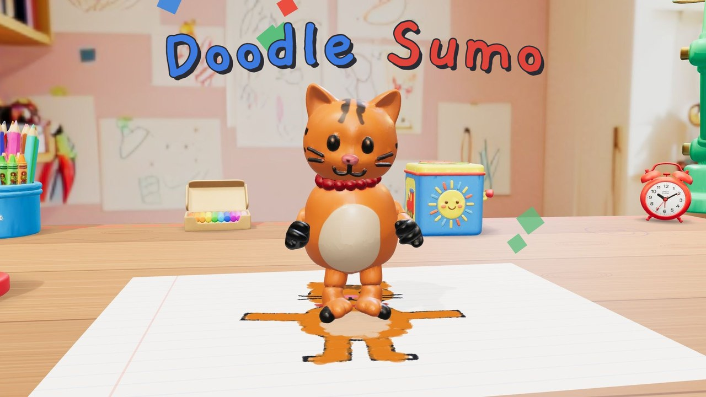

# Doodle Sumo

**Draw a doodle. Aholo Lux3D turns it into a 3D sumo toy in about three minutes. Then shove your rivals off a giant desk.**

Play it in the browser: **https://automationbot24x7.github.io/doodle-sumo/**
How every toy was made (live 3D viewers, joint sliders, print checks, full task log): **https://automationbot24x7.github.io/doodle-sumo/lab.html**

Demo video: **https://automationbot24x7.github.io/doodle-sumo/assets/video/doodle-sumo-demo.mp4**

[](https://automationbot24x7.github.io/doodle-sumo/assets/video/doodle-sumo-demo.mp4)

Project report (PDF): **[report/doodle-sumo-report.pdf](report/doodle-sumo-report.pdf)**

Built for the **Manycore Aholo Global 3D AI Hackathon** (#Manycorehackathon).

## The game

- **Draw your own fighter.** Scribble a character on the crayon pad (or use a photo of a paper drawing) and press *Bring it to life*. Lux3D returns a toy concept image, a 3D model, a skeleton and ten moves, live, and each result appears on the desk as it lands. The new toy joins the roster in your browser, gets its weight, speed and power from its shape, and can be downloaded for 3D printing.
- Or pick one of the six house doodles: Big Tofu, Captain Eraser, Mugsy, Volt, Pip or Gummy.
- Four toys drop onto a kid's desk. Shove (hold to charge) and dash-roll to push everyone else off the edge. Last toy standing wins the round; first to two rounds wins.
- The desk fights back: a stapler snaps shut, a desk fan blows gusts across the desk, and a jack-in-the-box winds up and blasts everyone nearby.
- The winner dances, and you can download that toy as a 3D-print file (.3mf / .stl).
- 1 player against three bots, or 2 players on one keyboard. Touch controls on phones.

| | Player 1 | Player 2 |
|---|---|---|
| Move | WASD (or arrows in 1-player) | Arrows |
| Shove (hold to charge) | J (or Space) | . |
| Dash roll | K (or Shift) | / |

## How Aholo Lux3D made everything

Every 3D asset in the game came out of Aholo Lux3D through its API. Nothing was modelled, rigged or animated by hand.

**Fighters** (`pipeline/fighter.mjs` for the house roster, `relay/core.mjs` for the live forge):

1. **Doodle**: a flat crayon sketch.
2. **Toy concept**: Lux3D multimodal image generation turns the doodle into a vinyl-toy picture of the same character in a T-pose.
3. **3D model**: Lux3D image-to-3D. Every house fighter was generated with both G1 and G1-Turbo and the better one kept; the live forge uses G1-Turbo (about a minute).
4. **Skeleton**: Lux3D humanoid auto-rig.
5. **Moves**: Lux3D animation retarget. Ten clips per fighter: idle, sumo stance, run, sprint, shove, jab, dash roll, falling flail, victory dance and cheer.
6. **Print file**: Lux3D multi-format export to 3MF and STL. `tools/print-check.mjs` confirms each STL is watertight.

**Desk traps** (`pipeline/prop.mjs`): Lux3D text-to-3D makes the object. Lux3D articulation then takes a plain-language motion prompt ("add a hinge at the back so the top arm snaps shut") and returns a URDF: separate part meshes joined by real joints with axes and limits. The game loads the URDF (`src/urdf.js`) and drives the stapler's hinge, the fan's rotor and the jack-in-the-box lid and crank directly through those joints. The original Lux3D URDF packages can be downloaded from the Lab page.

**Desk props**: pencil cup, book stack, alarm clock, rubber duck, crayon box and lamp, all made with Lux3D text-to-3D.

**The room**: a 360° bedroom from Aholo SpatialGen world generation.

Every Lux3D task is logged with its ID and timing; the Lab page lists them.

## The live forge

The browser never sees an API key. A small relay (`relay/core.mjs`, about 200 lines) accepts the drawing, runs the four Lux3D tasks one after another and hands back the result links; the browser downloads the finished toy and keeps it in IndexedDB.

On the live site the relay runs as a Cloudflare Worker (`relay/worker.mjs`, free plan) with the project's own Aholo key. Because every forge spends real Lux3D credits, the shared key is capped: 10 forges a day for everyone, 2 a day per visitor, 40 in total. When the free forges are used up, a visitor can paste their own Aholo API key in the forge screen; it is kept in that browser tab and sent only to the relay, which passes it to Lux3D.

To run the forge on your own machine with your own Aholo key (from labs.aholo.ai/api-keys):

```bash
AHOLO_KEY=your-key node relay/local.mjs
python -m http.server 8000
```

Then open http://localhost:8000 and press *Draw your own*. One fighter costs about 34 credits.

## Run locally

Static site, no build step:

```bash
python -m http.server 8000
```

Then open http://localhost:8000. Add `?demo` to the URL to let bots play every slot.

Regenerating the house assets needs your Aholo key in `Credentials/aholo-key.txt` or the `AHOLO_KEY` environment variable. Then run `pipeline/batch-fighters.sh` and `pipeline/batch-props.sh`, followed by `node tools/build-data.mjs`.

## How the demo video was recorded

The video is a screen recording of the real game in Chrome (`tools/capture.mjs`), including a real Lux3D forge run; waiting time is shown sped up and the real seconds are on screen. For the recording, the doodle's strokes were sent to the drawing pad by a script (`tools/draw-doodle.js`, real pointer events) and Player 1 was driven through the normal keyboard controls by `tools/autopilot.js`.

## Tools used

- **Aholo Lux3D** (via the Aholo API): all 3D models, toy concept images, rigging, animation, articulation and print exports.
- **Aholo SpatialGen**: the bedroom panorama.
- **three.js**: rendering. **glTF-Transform**: texture resizing and meshopt compression of the Lux3D output.
- **Claude Code**: AI coding assistant that wrote the game and pipeline code.
- Sound is synthesised live in the browser with WebAudio; there are no audio files.

## Licence

Code: MIT. The doodles are original. The 3D assets were generated with Aholo Lux3D and are subject to Aholo's terms of use.
